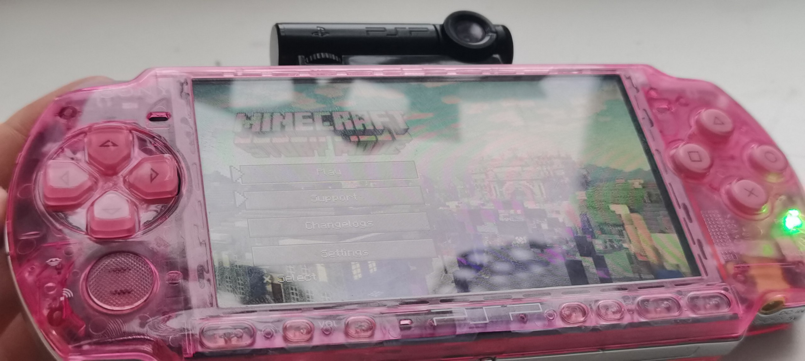
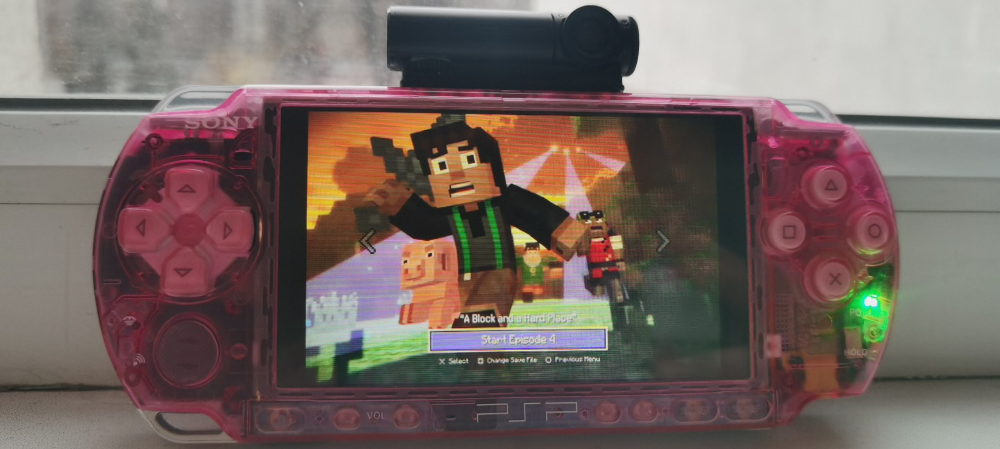
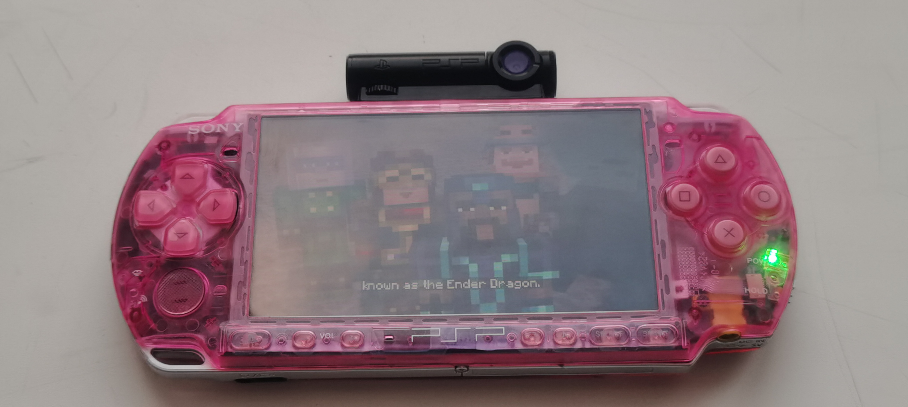
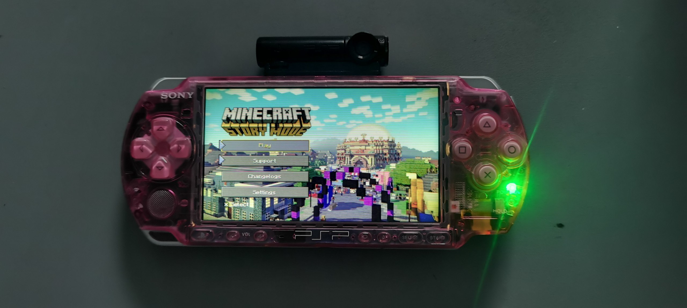

# Minecraft: Story Mode Portable

**A fan port of Minecraft: Story Mode, Season 1 to the Sony PSP**

[Русская версия](./README_RU.md)

 

 

 
 

 

All five episodes of the Netflix interactive edition play as video on the PSP, with the choices, the menus and the saves of the original game.

This is a fan project. It is not affiliated with Mojang, Microsoft, Telltale Games or Netflix. The original game and its Netflix version are no longer sold, but the game is still worth playing.

## Features

- **The whole season.** All five episodes with their branches; the choices you make carry over to the later episodes.
- **Timed choices**, as in the original game. The timer can be switched off in the settings.
- **Interactive zones**, where you choose what to look at and whom to talk to.
- **Saves.** Autosave and four save slots.
- **Seven languages:** English, Russian, Ukrainian, Spanish, Portuguese (Brazil), Portuguese (Portugal) and German. More can be added as language packs.
- **The menus of the original game**, recreated for the PSP screen.

## Requirements

| | |
|---|---|
| **Console** | Any PSP, the PSP-1000 included, with custom firmware; or the PPSSPP emulator |
| **Free space** | About 4 GB on the memory stick, almost all of it video |

## Installation

1. Download the latest release from [the releases page](https://git.entitybtw.ru/entitybtw/mcsm_portable/releases/latest) (or [from GitHub](https://github.com/entitybtw/mcsm_portable/releases/)).
2. Copy the game folder to `PSP/GAME/` on the memory stick, so that the file is at `PSP/GAME/<folder>/EBOOT.PBP`.
3. Start the game from the XMB, or open `EBOOT.PBP` in PPSSPP.

<b>Running from the source</b>

 

Clone the repository with [Git LFS](https://git-lfs.com/) installed and run `git lfs pull`: the videos and the subtitles are LFS files. Then copy `EBOOT.PBP`, the `.lua` files and `assets/` to the memory stick in the same way.

## Community

### Stoat (main)

The community of the project lives on **Stoat**: news, releases, bug reports and talk.

Stoat is an open-source chat app, much like Discord: servers, channels, voice, roles, all in the browser or in an app. Our server runs on its own instance, a fork of Stoat with the same features and many bugs fixed. A few things to know:

- **It is a separate site.** Your Discord account does not work there: sign up on [stoat.entitybtw.ru](https://stoat.entitybtw.ru) once, it takes a minute.
- **The invite** brings you straight to the server: https://stoat.entitybtw.ru/invite/b2ATGEb9
- **Where to use it.** In the browser, nothing to install; or in the desktop client, [stoat-desktop](https://git.entitybtw.ru/entitybtw/stoat-desktop). A mobile client, [stoatgram](https://git.entitybtw.ru/entitybtw/stoatgram), is in development.
- **The source of the instance** is open: [git.entitybtw.ru/entitybtw/stoat-selfhosted](https://git.entitybtw.ru/entitybtw/stoat-selfhosted)

### Discord (abandoned)

The old Discord server is no longer kept up and nothing new is posted there; come to Stoat instead. It stays open for history: https://discord.gg/5R7YEe4q2G

## For developers

The documentation is in [`docs/`](docs/README.md):

| Page | What it covers |
|---|---|
| [ENGINE.md](docs/ENGINE.md) | The engine and its Lua API |
| [GAME.md](docs/GAME.md) | The story graph, choices, saves, menus, how the videos are made |
| [LANGUAGES.md](docs/LANGUAGES.md) | Languages, subtitles, the glossary of names and terms |
| [TESTING.md](docs/TESTING.md) | Testing in PPSSPP and on a PSP over PSPLink |

The engine is **LuaPlayerYT-MCSM**, a Lua player for the PSP kept in a separate repository: it plays the PMP videos with their subtitles, draws with the GPU and runs the Lua scripts of the game. `EBOOT.PBP` is the build for the XMB, `EBOOT_dev.prx` the one for PSPLink. Building the engine needs [pspdev](https://github.com/pspdev/pspdev); the scripts and the assets need no build.

<b>Languages and language packs</b>

 

Every language is a folder of `assets/langs/`, the built-in ones and the packs alike: the game finds them at start and lists them in Settings > Language. A pack needs only a `lang.json` and the files it translates; whatever it lacks is shown in its base language. The format is described in [`assets/langs/README.txt`](assets/langs/README.txt).

## Repository

The main repository is on [git.entitybtw.ru](https://git.entitybtw.ru/entitybtw/mcsm_portable) (self-hosted). [GitHub](https://github.com/entitybtw/mcsm_portable) is its mirror; issues and pull requests there are still read.

## Thanks

| | |
|---|---|
| **pox1016** | for adapting Minecraft: Story Mode Netflix Interactive to YouTube |
| **Antim** | for a lot of advice and bug fixes |
| **dntrnk** | for the menu improvements and big optimizations |

And to the many contributors and everyone who gives advice and helps with the development.

 

Thank you for supporting the project. Contributions and bug reports are welcome.

