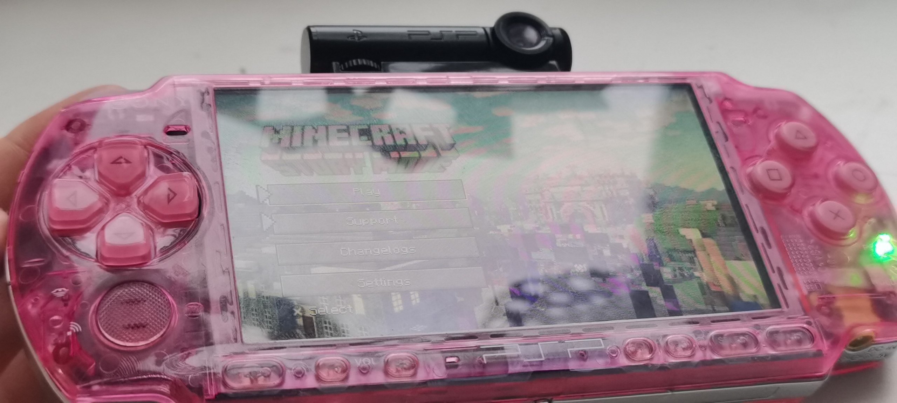
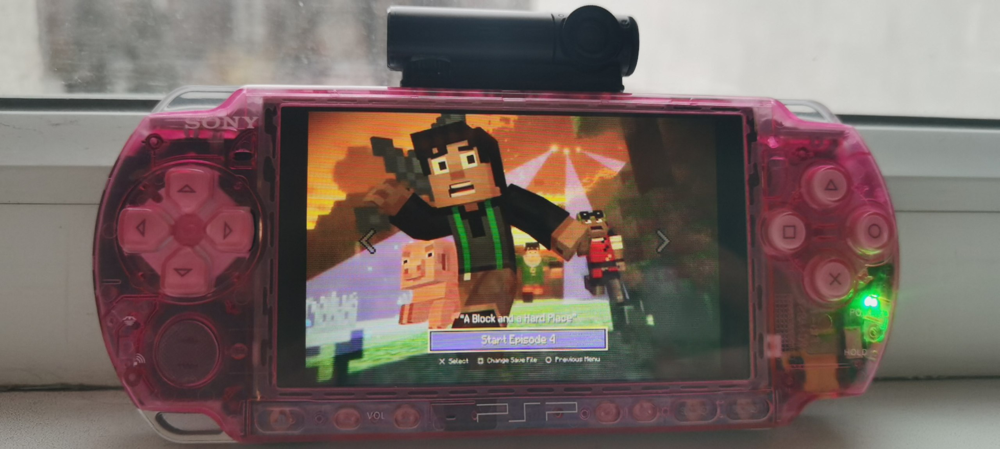
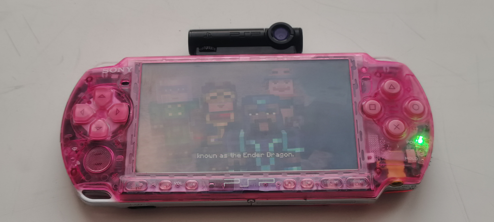
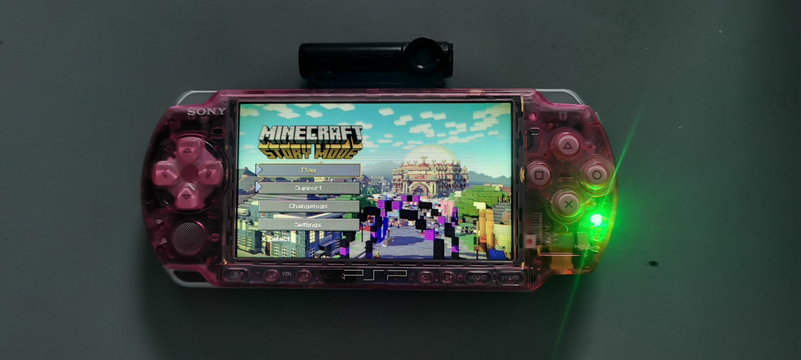

# Minecraft: Story Mode Portable

**Фанатский порт Minecraft: Story Mode, сезон 1 на Sony PSP**

[English version](./README.md)

 

 

 
 

 

Все пять эпизодов интерактивной версии Netflix идут на PSP видео, с выборами, меню и сохранениями оригинальной игры.

Это фанатский проект, он не связан с Mojang, Microsoft, Telltale Games или Netflix. Оригинальная игра и её версия на Netflix больше не продаются, но игра по-прежнему стоит того, чтобы в неё сыграть.

## Возможности

- **Весь сезон.** Все пять эпизодов со всеми ветками; сделанные выборы переходят в следующие эпизоды.
- **Выборы на время**, как в оригинальной игре. Таймер можно отключить в настройках.
- **Интерактивные зоны**, где вы сами выбираете, что осмотреть и с кем поговорить.
- **Сохранения.** Автосохранение и четыре слота.
- **Семь языков:** английский, русский, украинский, испанский, португальский (Бразилия), португальский (Португалия) и немецкий. Другие можно добавить языковыми паками.
- **Меню оригинальной игры**, воссозданные под экран PSP.

## Требования

| | |
|---|---|
| **Консоль** | Любая PSP, включая PSP-1000, с кастомной прошивкой; или эмулятор PPSSPP |
| **Место** | Около 4 ГБ на карте памяти, почти всё — видео |

## Установка

1. Скачайте последний релиз на [странице релизов](https://git.entitybtw.ru/entitybtw/mcsm_portable/releases/latest) (или [на GitHub](https://github.com/entitybtw/mcsm_portable/releases/)).
2. Скопируйте папку игры в `PSP/GAME/` на карте памяти, чтобы файл оказался в `PSP/GAME/<папка>/EBOOT.PBP`.
3. Запустите игру из XMB или откройте `EBOOT.PBP` в PPSSPP.

<b>Запуск из исходников</b>

 

Склонируйте репозиторий с установленным [Git LFS](https://git-lfs.com/) и выполните `git lfs pull`: видео и субтитры хранятся в LFS. Затем так же скопируйте `EBOOT.PBP`, файлы `.lua` и `assets/` на карту памяти.

## Сообщество

### Stoat (основной)

Сообщество проекта живёт в **Stoat**: новости, релизы, сообщения об ошибках и общение.

Stoat — это мессенджер с открытым исходным кодом, очень похожий на Discord: серверы, каналы, голосовые чаты, роли, всё прямо в браузере или в приложении. Наш сервер работает на собственном инстансе — это форк Stoat, в котором всё то же самое, а многие баги исправлены. Что нужно знать:

- **Это отдельный сайт.** Аккаунт Discord там не подойдёт: один раз зарегистрируйтесь на [stoat.entitybtw.ru](https://stoat.entitybtw.ru), это займёт минуту.
- **Приглашение** сразу приводит на сервер: https://stoat.entitybtw.ru/invite/b2ATGEb9
- **Где пользоваться.** В браузере, ничего не устанавливая, или в десктопном клиенте [stoat-desktop](https://git.entitybtw.ru/entitybtw/stoat-desktop). Мобильный клиент, [stoatgram](https://git.entitybtw.ru/entitybtw/stoatgram), в разработке.
- **Исходники инстанса** открыты: [git.entitybtw.ru/entitybtw/stoat-selfhosted](https://git.entitybtw.ru/entitybtw/stoat-selfhosted)

### Discord (заброшен)

Старый сервер Discord больше не ведётся, нового там не появляется; приходите в Stoat. Он остаётся открытым как архив: https://discord.gg/5R7YEe4q2G

## Разработчикам

Документация лежит в [`docs/`](docs/README.md) (на английском):

| Страница | О чём |
|---|---|
| [ENGINE.md](docs/ENGINE.md) | Движок и его Lua API |
| [GAME.md](docs/GAME.md) | Граф сюжета, выборы, сохранения, меню, как делаются видео |
| [LANGUAGES.md](docs/LANGUAGES.md) | Языки, субтитры, глоссарий имён и терминов |
| [TESTING.md](docs/TESTING.md) | Тесты в PPSSPP и на PSP через PSPLink |

Движок — **LuaPlayerYT-MCSM**, Lua-плеер для PSP, который лежит в отдельном репозитории: он проигрывает видео PMP с субтитрами, рисует через GPU и выполняет Lua-скрипты игры. `EBOOT.PBP` — сборка для XMB, `EBOOT_dev.prx` — для PSPLink. Для сборки движка нужен [pspdev](https://github.com/pspdev/pspdev); скрипты и ассеты собирать не нужно.

<b>Языки и языковые паки</b>

 

Каждый язык — это папка в `assets/langs/`, и встроенные, и паки: игра находит их при запуске и показывает в Настройки > Язык. Паку нужны только `lang.json` и те файлы, которые он переводит; всё, чего в нём нет, показывается на его базовом языке. Формат описан в [`assets/langs/README.txt`](assets/langs/README.txt).

## Репозиторий

Основной репозиторий — на [git.entitybtw.ru](https://git.entitybtw.ru/entitybtw/mcsm_portable) (свой сервер). [GitHub](https://github.com/entitybtw/mcsm_portable) — его зеркало; жалобы и пулл-реквесты там я по-прежнему читаю.

## Спасибо

| | |
|---|---|
| **pox1016** | за адаптацию Minecraft: Story Mode Netflix Interactive для YouTube |
| **Antim** | за кучу советов и исправление багов |
| **dntrnk** | за улучшения меню и большие оптимизации |

А также множеству контрибьюторов и всем, кто даёт советы и помогает в разработке.

 

Спасибо за поддержку проекта. Помощь и сообщения об ошибках приветствуются.

